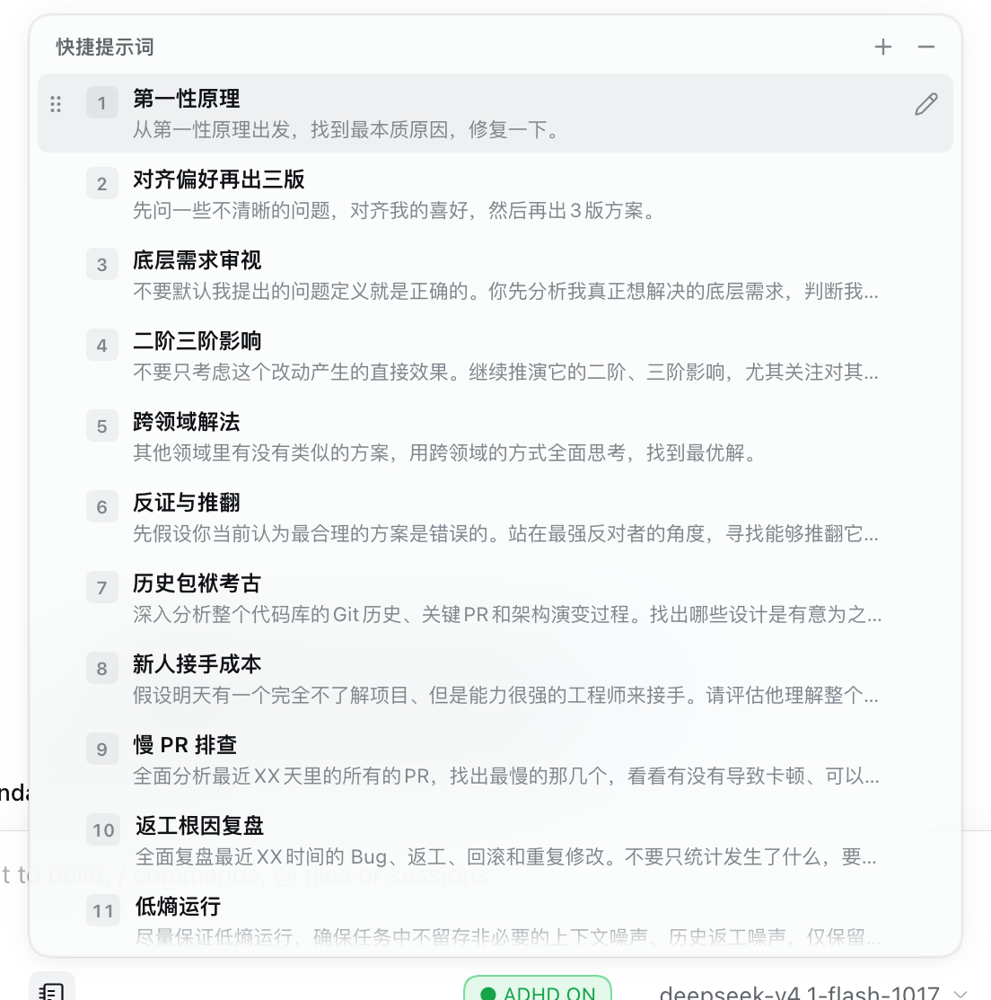

# dsh-prompt-book

Reusable prompt presets inside the [DeepSeek Harness](https://github.com/deepseek-ai/deepseek-harness)
(`dsh`) composer. One notebook button in the composer tool row — between the
permission selector and the ADHD badge — opens a list of prompts. Picking one
**inserts it into the draft at the caret and hands focus back to the composer**,
so you keep typing and press `Enter` to send. It never sends anything by itself.



## Install

```bash
dsh plugin --profile web add github:yuanyuanzhang0815/dsh-prompt-book
```

`dsh plugin add` registers the bundle in your profile automatically; the running
profile then reconciles it on its own. Restart `dsh` only if the button does not
appear. Installed from GitHub there is no build step: `client.js` is plain
browser JavaScript, loaded by the module loader inside the web app.

For local development, link a checkout instead:

```bash
dsh plugin --profile web add "link:$HOME/.dsh/plugins/dsh-prompt-book"
```

Remove with `dsh plugin --profile web remove dsh-prompt-book` and drop the
`dsh.profile.bundles` entry.

## What ships in the box

Fourteen presets, all editable, all replaceable — they are starting points for
thinking prompts rather than fixed commands:

| # | Label | Prompt |
|---|---|---|
| 1 | **第一性原理** | 从第一性原理出发，找到最本质原因，修复一下。 |
| 2 | **对齐偏好再出三版** | 先问一些不清晰的问题，对齐我的喜好，然后再出3版方案。 |
| 3 | **底层需求审视** | 不要默认我提出的问题定义就是正确的。你先分析我真正想解决的底层需求，判断我有没有把症状误认为原因、把手段误认为目标。如果存在更值得解决的问题，直接指出来。 |
| 4 | **二阶三阶影响** | 不要只考虑这个改动产生的直接效果。继续推演它的二阶、三阶影响，尤其关注对其他模块、用户行为、系统复杂度和长期维护成本的潜在影响。 |
| 5 | **跨领域解法** | 其他领域里有没有类似的方案，用跨领域的方式全面思考，找到最优解。 |
| 6 | **反证与推翻** | 先假设你当前认为最合理的方案是错误的。站在最强反对者的角度，寻找能够推翻它的证据、反例和边界情况。然后重新评估方案，看看有没有更好的解法。 |
| 7 | **历史包袱考古** | 深入分析整个代码库的Git历史、关键PR和架构演变过程。找出哪些设计是有意为之，哪些是历史遗留，哪些是为了解决已经不存在的问题而引入的。识别可以安全移除的历史包袱。 |
| 8 | **新人接手成本** | 假设明天有一个完全不了解项目、但是能力很强的工程师来接手。请评估他理解整个项目需要付出的认知成本，找出那些命名混乱、抽象过度、职责不清晰、需要大量上下文才能理解的代码，并提出简化方案。 |
| 9 | **慢 PR 排查** | 全面分析最近XX天里的所有的PR，找出最慢的那几个，看看有没有导致卡顿、可以优化的地方。 |
| 10 | **返工根因复盘** | 全面复盘最近XX时间的 Bug、返工、回滚和重复修改。不要只统计发生了什么，要分析这些问题背后有没有共同的根因。把能够预防的共性问题沉淀成项目规则、自动化或者Skill，避免我们反复支付同样的成本。 |
| 11 | **低熵运行** | 尽量保证低熵运行，确保任务中不留存非必要的上下文噪声、历史返工噪声，仅保留正向流程。 |
| 12 | **UX 打磨到可交付** | 从用户体验的视角，去对整体产品UI、UX设计做优化，去掉无用说明、改掉用户不懂的晦涩文字、最大程度简化用户操作，优化后使产品达到可交付的标准状态。 |
| 13 | **跨领域经典变体** | 目前存在的问题是否是其他领域经典问题的变体，有无成熟的解决方案，请进行跨领域的广度搜索核实这一点。 |
| 14 | **用产品语言解释** | 用产品经理能听懂的话解释。先说这件事对产品、用户和边界的影响与取舍，再讲技术实现；不要堆纯技术术语，也不要把实现细节当成结论。如果一句话说不清，先给结论再展开。 |

## Using it

- Click the notebook icon → a 520 px panel opens above the composer, clamped to
  the viewport, opening upward or downward depending on the space available.
- Each row shows a one-line preview. **Hover or focus a row and it expands to the
  full body**, so nothing has to be guessed from a truncated line.
- `↑` / `↓` move, `Enter` inserts, `1`–`9` and `0` insert the first ten entries
  directly. `Esc` closes.
- Inserting into a non-empty draft adds a blank line between the old text and the
  prompt. The caret then sits at the end of the inserted text, in the composer.
- Every row starts with a six-dot grip: drag it to reorder, or focus a row and
  press `Alt` + `↑` / `↓`. The order is saved when you drop it.
- **Pencil** (appears on the hovered row) edits that row in place: label, body,
  保存 / 取消. There is no separate editor page.
- **Plus** in the header appends a new blank row, opened in the same inline editor.
- **Minus** next to it toggles delete mode: every row shows a red trash button, one
  click removes that entry, and a centred undo bar keeps it recoverable for five
  seconds. Row clicks and digit shortcuts are disabled while deleting, so a near
  miss cannot insert anything.

## Storage

Everything the user changes lives in the browser, not on disk:
`localStorage['dsh-quick-prompts.presets.v2']` (the key keeps its original name so
lists saved before the rename survive) holds the **whole list** as
`[{ id, label, content }]`, so it can grow and shrink. A row with an empty body is
skipped when picked. The older positional key `…presets.v1` is read once and
migrated on the next save. Clear both keys to get the shipped fourteen back.

## How it plugs into dsh

- `index.js` — host entry, a no-op `apply()`; the plugin is client-only.
- `cordis.patch.yml` — inserts the bundle as `prompt-book`.
- `client.js` — the whole UI: styles, preset store, menu, inline row editor,
  pointer-drag reordering with a FLIP animation.
- `package.json` — `dsh.client` declares `inject: ['slots']`, `platform: 'web'`,
  and the bundle patch; `dsh.bundle` is what `dsh plugin add` reads.

The button registers into the `conversation.input.left` slot (a session-scoped
list slot in the composer tool row). Insertion uses the plugin-facing
`inputActions` contract: `captureInsertion()` for a compare-and-swap token,
`insertText(text, span)`, with `setDraft()` as a fallback. Focus and caret are
restored through the DOM, because the contract has no `focus()`; the insertion
survives the re-render that follows because the caret is re-asserted on the next
animation frame.

## Credits

Forked from [`dsh-prompt-chips`](https://github.com/yunxiao11xie/dsh-prompt-chips)
(MIT) rather than written from scratch: its slot registration, caret insertion and
keyboard navigation already worked. What changed here:

- four fixed chips → an editable preset list stored as a whole (add, edit, delete,
  reorder), with the fourteen prompts above as defaults;
- `react-dom` portal → a viewport-clamped fixed panel, so the menu cannot be
  clipped by the composer's overflow;
- Chinese copy by default, Lucide stroke icons to match dsh's own toolbar, drag
  reordering with a FLIP animation, and focus handed back to the composer.

## License

MIT — see [LICENSE](LICENSE), which also carries the upstream `dsh-prompt-chips` copyright.
